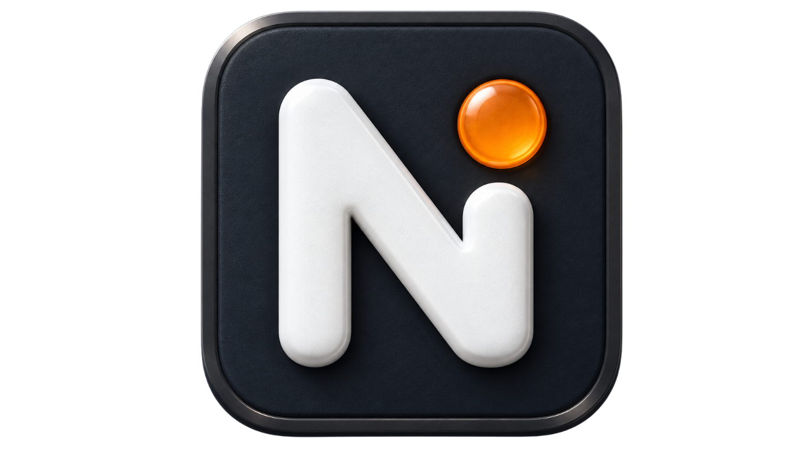

# Nebulae

<p align="center">
  
</p>

<p align="center">
  <strong>Torrent Client by Asian DVD Club</strong><br>
  <em>Native Desktop Application for Windows and macOS</em>
</p>

<p align="center">
  <a href="#about">About</a> •
  <a href="#core-features">Features</a> •
  <a href="#installation">Installation</a> •
  <a href="#packages">Packages</a> •
  <a href="#internal-storage">Internal Storage</a> •
  <a href="#code-signing-policy">Code Signing Policy</a> •
  <a href="#development">Development</a>
</p>

---

## About

**Nebulae** is a modern, privacy-focused peer-to-peer file-transfer client designed for communities, archives, and organizations sharing content with permission.

Nebulae desktop packages include **Nebulae Core** for downloads and seeding and **Nebulae Cinema** for integrated media and disc playback. You do not need to install Transmission or VLC separately.

It combines a clean, media-friendly interface inspired by Asian DVD Club's visual styling with advanced connectivity diagnostics, Smart Peering telemetry, isolated VPN socket binding, and community torrent-management tools.

### Designed for Communities

Nebulae is built for:
- **Creators** distributing their own work directly to audiences
- **Open-source projects** sharing large ISO images and binary releases
- **Archives and preservation communities** protecting cultural artifacts
- **Families and organizations** exchanging large media archives
- **Media communities** organizing lawful digital collections
- **Private communities** that operate with clear rules and member trust

Nebulae does not host, index, search, recommend, or distribute content.

---

## Core Features

- **Dual UI Modes**:
  - **Simple Media Mode**: Netflix-style shelves (*Active Downloads*, *Recently Added*, *Completed*, *Seeding*, *Ready to Watch*), poster-style media cards, and single-click playback powered by **Nebulae Cinema**.
  - **Torrent Manager Mode**: Power-user table view with status filters, categories, search, and a deep tabbed inspector (*Files*, *Trackers*, *Peers*, *Speed*, *Log*) powered by **Nebulae Core**.
- **Nebulae Cinema**: Integrated media and disc playback system supporting interactive DVD (`VIDEO_TS`, ISO), Blu-ray (`BDMV`, ISO), and 4K UHD menus with no separate media player installation required.
- **Nebulae Core Torrent Engine**: Reliable downloading and seeding engine with private swarm safeguards (automatic permanent disable of DHT, PEX, and LSD on private swarms).
- **Smart Peering Engine**: Passive latency, throughput, and reciprocity telemetry with rolling quality scoring and 5 selectable peering modes (*Balanced*, *Speed First*, *Latency First*, *Local First*, *Privacy First*).
- **Connectivity Doctor**: Detects listening port reachability, UPnP/NAT-PMP/PCP availability, dual-stack IPv4/IPv6 health, and DNS latency with guided router port-forwarding instructions.
- **VPN for ADC Only**: Supports importing WireGuard (`.conf`) and OpenVPN (`.ovpn`) profiles. Binds torrent engine sockets directly to the VPN interface without redirecting your browser or system applications. Includes an integrated Kill Switch that pauses transfers if the VPN drops.
- **AsianDVDClub Community Framework**: Passkey masking and OS Keychain storage, ratio dashboard, Seed Time Shield, and private torrent safeguards.
- **Cinematic Startup Splash**: Archive splash screen displaying initialization progress and a community invitation to visit `asiandvdclub.org`.

---

<a name="packages"></a>
## Shipped Executables & Packages

All published binaries, installers, and packages use the approved naming convention:

| Platform | Target Architecture | Package / Executable |
| :--- | :--- | :--- |
| **Windows x64** | `x86_64-pc-windows-msvc` | `Nebulae-Setup-x64.exe` (installs `nebulae.exe`) |
| **macOS Apple Silicon (M1/M2/M3/M4/M5)** | `aarch64-apple-darwin` | `Nebulae-macOS-arm64.dmg` (mounts `Nebulae.app`) |
| **macOS Intel** | `x86_64-apple-darwin` | `Nebulae-macOS-x64.dmg` (mounts `Nebulae.app`) |
| **Protocol Handler** | Cross-platform | `adc://` and `magnet:?` |

---

## Installation

Detailed installation instructions covering Windows SmartScreen, macOS Gatekeeper, firewall permissions, router port forwarding, and troubleshooting are available in:

📖 **[Full Installation Guide (docs/installation.md)](docs/installation.md)**

---

## Nebulae Server (Docker)

Nebulae Server is a complete headless deployment powered by Nebulae Core, Nebulae’s bundled torrent engine. The Docker image includes the required server components; no separate torrent-engine installation is needed. Run the server on a NAS, home server or seedbox and control it from the desktop app's **Server** tab. Image: `ghcr.io/koppot/nebulae-server:0.2.8` (linux/amd64).

```bash
export NEBULAE_TOKEN="$(openssl rand -hex 32)"
docker run -d --name nebulae-server --restart unless-stopped --platform linux/amd64 \
  -e NEBULAE_TOKEN="$NEBULAE_TOKEN" -p 9174:9174 -p 51413:51413 -p 51413:51413/udp \
  -v nebulae-downloads:/data/downloads -v nebulae-config:/data/config -v nebulae-watch:/data/watch \
  ghcr.io/koppot/nebulae-server:0.2.8
```

Then in the desktop app: **Settings → Server** → check **Connect to a Nebulae Server (Transmission)** (this is the UI label in the released application, connecting to the bundled Nebulae Core server) → `http://<server-ip>:9174` + token → **Test connection**.

📖 **[Full guide: architecture, Compose, platforms, security, trackers, troubleshooting (docs/nebulae-server.md)](docs/nebulae-server.md)**

---

## Code signing policy

> **SignPath Foundation application declined due to insufficient project history. Windows beta builds are currently unsigned unless another signing provider is configured.**

Windows artifacts in current releases are **unsigned** beta builds; SmartScreen will warn about an unrecognized publisher on first run. No certificate has been issued, and no signing provider is active. The [code signing policy](docs/code-signing-policy.md) states the provider-neutral rules that will govern signed releases under whichever provider is onboarded in the future.

- Full policy (roles, approvers, verifiable-build rules, per-release manual approval): **[docs/code-signing-policy.md](docs/code-signing-policy.md)**
- Privacy policy: **[docs/privacy.md](docs/privacy.md)**
- Roles: Authors/Committers and Reviewers: [koppot](https://github.com/koppot) (repository owner) · Signing approvers: [koppot](https://github.com/koppot)

---

## Internal Storage & Diagnostics

Technical files are strictly isolated from the main user interface:

- **macOS**: `~/Library/Application Support/Nebulae/internal/`
- **Windows**: `%LOCALAPPDATA%\Nebulae\internal\`

```text
internal/
├── db/             # Local SQLite database (nebulae.db)
├── logs/           # Redacted session logs (nebulae_session.log)
├── cache/          # Fast-resume state & temporary piece cache
├── engine-state/   # BitTorrent engine checkpoints & DHT cache
└── diagnostics/    # Crash and panic reports
```

### Developer Mode ("Der Sperre")
Developer diagnostics and internal log exports are housed in the **Show Advanced Diagnostics** section under Settings, identified by the developer mark (*Der Sperre*). Secrets, passkeys, and magnet URIs are automatically redacted.

---

## Local Development & Build

### Prerequisites
- Node.js 18+ and `pnpm`
- Rust 1.75+ with Cargo

### Running Locally
```bash
# Clone the repository
git clone https://github.com/koppot/Nebulae-torrent_client.git
cd Nebulae-torrent_client

# Install frontend dependencies
pnpm install

# Run desktop application in development mode
pnpm tauri dev
```

### Building Release Installers
```bash
# Build production bundle for the current host OS
pnpm tauri build
```

---

## License

Licensed under the MIT License ([LICENSE](LICENSE)).
